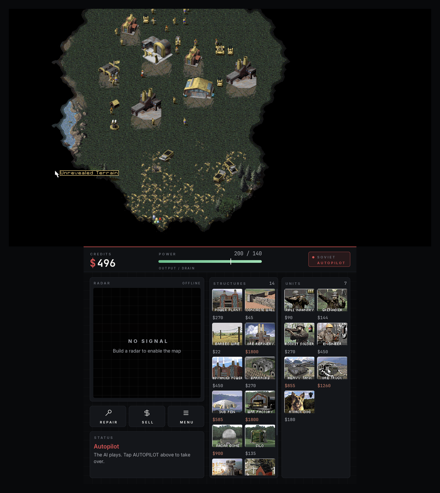
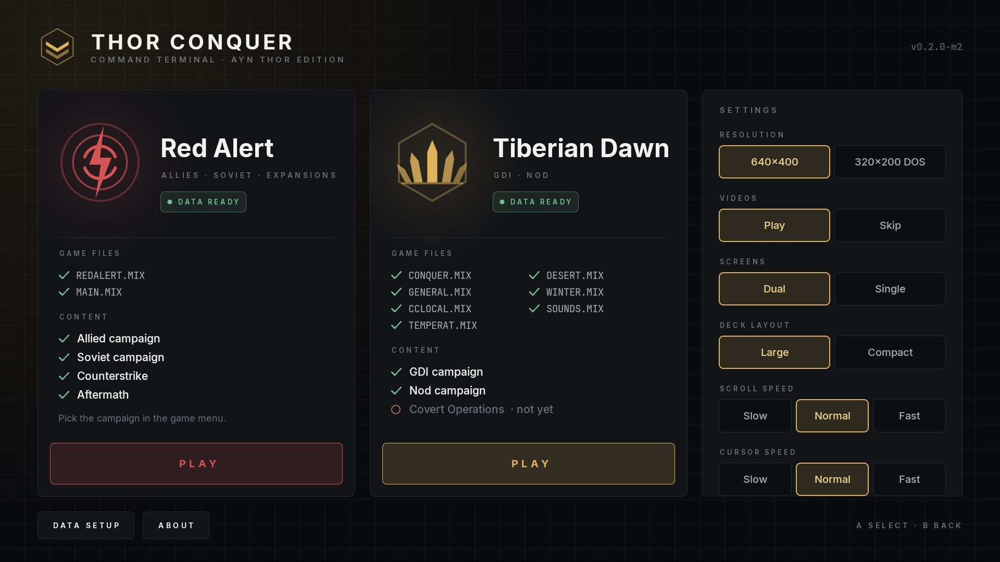

# Thor Conquer

**Command & Conquer: Tiberian Dawn and Red Alert, native on the AYN Thor, with a command deck on the second screen.**

Thor Conquer is an Android (arm64) build of [Vanilla Conquer](https://github.com/TheAssemblyArmada/Vanilla-Conquer) made for the AYN Thor dual-screen handheld:

- **Top screen (1920×1080):** only the tactical map. The engine renders 960×540 and is scaled exactly 2× (pixel-perfect, no stretching, no bars), so you see far more of the battlefield at the classic sprite size. The sidebar and the top tab bar are gone. Menus, films and the score screen keep their original 640×400 layout and are shown as a centred frame, also at 2×. Maps smaller than the screen are centred on black.
- **Bottom screen (1240×1080):** a touch command deck with credits, a power meter, a framed radar, REPAIR / SELL / MENU, a jump row (UNITS / BASE / GROUP / ALERT), and two build columns with the in-game cameos, build progress, READY and ON HOLD badges.
- **Controller and touch** on the top screen, a launcher with data check and settings, and an English UI with German, Spanish and French translations.





> Thor Conquer ships **no game data**; it runs on the original files from your own copy of the *C&C Remastered Collection*. The in-game picture above is rendered from the author's own copy.

**Video:** [AYN Thor: I Made Red Alert a DUAL-SCREEN Game](https://youtu.be/ZMGUqJJKna8)

**Download:** the APK is on the [Releases](../../releases) page (arm64, Android 13+).

---

## Quick start

▶ **[Watch the install guide](https://youtu.be/EZCMScoWK7o)** (2 min) · **[Full video](https://youtu.be/ZMGUqJJKna8)**

1. Install the APK from the [releases](https://github.com/harmssi/thor-conquer/releases) (Chrome: *Download anyway* → *Package installer* → *Settings* → *Allow from this source* → *Install*).
2. Start the app. The launcher shows **DATA MISSING**; **DATA SETUP** shows the target folder.
3. Copy `Data/CNCDATA` from your Steam *C&C Remastered Collection* to `/sdcard/Android/data/de.harmssi.thorconquer/files/` in the structure shown under [Game data](#game-data). Android only allows this from a PC over USB, or with `thor/copy-data.sh`.
4. Restart the app: **DATA READY** → Play.

> Uninstalling the app deletes the data folder – keep a copy.

If it works for you, a ⭐ on GitHub helps.

---

## Features

| | |
|---|---|
| **Dual screen** | The deck is an Android `Presentation` on display 4 (`FLAG_NOT_FOCUSABLE`, so the controller stays with the game). If there is no second screen, the classic sidebar is shown on the top screen instead. |
| **Engine-faithful** | Every deck action goes through the engine's normal input path: build clicks run through the original sidebar button code, a radar tap does what a radar click does, and REPAIR and SELL are the sidebar buttons. No game state is changed directly. |
| **Jump row** | UNITS: tap = centre on the next own unit (cycles), long-press = select all own units on screen. BASE: construction yard first, repeated taps cycle through your factories. GROUP: tap = jump to the selected units (if off screen), otherwise select + centre the next group; long-press = make the selection a group (next free number, same as Ctrl+1–9). ALERT: blinks for 30 s when your base is under attack, tap = jump to the last attacked building. Controller: R3 = next unit, L3 = base. |
| **Build deck** | Tap = build or deploy when READY. Tap again while building = hold. Long-press = hold, then cancel. The progress sweep is drawn over the cameo. The accent color follows the faction: amber for Allies/GDI, red for Soviet/Nod. |
| **Radar** | The minimap is rendered from the engine's cell colors, with a viewport frame. Tap or drag on it to scroll the map. |
| **Top-screen touch** | Tap = select / left click · drag = selection box · two-finger drag = scroll · long-press or two-finger tap = right click (deselect / cancel). |
| **Controller** | Left stick = cursor, right stick = scroll, A = left click, B = right click, Select = Esc (menu), Start = Enter, X/Y = G/F, D-pad = 1–4. **L1/R1** move a focus ring through the deck's build items, and **A** builds the focused item while the ring is visible. |
| **Content** | Red Alert: Allied, Soviet, Counterstrike, Aftermath. Tiberian Dawn: GDI, Nod. Covert Operations is not supported yet. |
| **Game language** | The game itself uses the legacy files from `Data/CNCDATA`, which the Remastered Collection ships in English only. German, French etc. exist there only in the remastered formats (`*.MEG`), which the classic engine cannot read. The app UI is translated. |
| **Languages** | English (default), Deutsch, Español, Français. The app follows the system language; you can override it in Settings → Language. |

## Demo / autopilot mode (recording)

For videos without a player. The player's house is handed to the engine's own computer AI (the same thing the engine does when a multiplayer player disconnects); no game rules are changed. Music is off, sound effects stay on, and all videos are skipped. The camera glides calmly to new buildings and fights and does a "radar jump" every 20–40 s, shown as a pulse on the deck radar. From time to time a scripted deck tap builds something through the normal sidebar path, with an optional ripple on the cameo.

```sh
adb shell am start -n de.harmssi.thorconquer/.GameActivity \
    --es game ra --ez demo true --ei seed 1234 --ei opponents 2 --ei map 6 \
    [--ei speed 3] [--ez highlights false]
```

- Pick the map with `--es map_name "Equal Opportunity"` (part of the name, any language of the list) or `--ei map N` (index in the full list).
- `seed` makes a take repeatable.
- `speed` is the engine game speed (0 = fastest).
- Every event is logged with a timestamp to `/sdcard/Android/data/de.harmssi.thorconquer/files/demo-events.jsonl`. Each line holds `t_ms`, `type`, `mode` (scripted or automatic) and `desc`.
- The launcher has the same switch under Settings → Demo mode.

- Scripted deck taps rotate through useful items: a power plant when power is low, otherwise refinery → barracks → war factory → defense → infantry → vehicle.
- Tap the **AUTOPILOT** chip in the deck header to take over. The house is handed back to you, for example to fire a superweapon yourself.

Works in Red Alert and Tiberian Dawn. In TD the autopilot first drives the starting MCV to a free spot, using normal unit orders, because TD's AI does not move a blocked MCV by itself.

## Game data

You need your own copy of the **Command & Conquer Remastered Collection** (Steam). The legacy game files are in `Data/CNCDATA/`. Thor Conquer reads them from its own folder, so it needs no extra permissions:

```
/sdcard/Android/data/de.harmssi.thorconquer/files/
├── redalert/
│   ├── REDALERT.MIX  EXPAND.MIX  EXPAND2.MIX  HIRES1.MIX  LORES1.MIX   ← RED_ALERT/CD1
│   ├── allied/MAIN.MIX           ← RED_ALERT/CD1   (Allied + Soviet campaign)
│   ├── counterstrike/MAIN.MIX    ← RED_ALERT/COUNTERSTRIKE
│   └── aftermath/MAIN.MIX        ← RED_ALERT/AFTERMATH
├── tiberiandawn/
│   ├── CONQUER.MIX CCLOCAL.MIX LOCAL.MIX TEMPERAT.MIX DESERT.MIX WINTER.MIX SOUNDS.MIX
│   │   SPEECH.MIX SCORES.MIX TRANSIT.MIX UPDATE.MIX UPDATEC.MIX UPDATA.MIX
│   │   TEMPICNH.MIX DESEICNH.MIX WINTICNH.MIX ZOUNDS.MIX SC-000.MIX SC-001.MIX   ← TIBERIAN_DAWN/CD1
│   ├── gdi/GENERAL.MIX  gdi/MOVIES.MIX    ← TIBERIAN_DAWN/CD1
│   └── nod/GENERAL.MIX  nod/MOVIES.MIX    ← TIBERIAN_DAWN/CD2
└── config/                       ← settings and save games (created by the app)
```

Disc-specific files go into sub folders, the engine's "local CD" folders. A flat layout with everything in `redalert/` or `tiberiandawn/` also works, but then only the first campaign or disc is playable.

**Minimum:** Red Alert needs `REDALERT.MIX` + `MAIN.MIX`. Tiberian Dawn needs `CONQUER.MIX`, `GENERAL.MIX`, `CCLOCAL.MIX`, `TEMPERAT.MIX`, `DESERT.MIX`, `WINTER.MIX` and `SOUNDS.MIX`. The launcher shows a checklist and what is missing. Case does not matter, and empty files count as missing.

**Steam on the device (e.g. DroiDeck):** `thor/copy-data.sh` copies everything over adb in one step. It only reads the Steam folder:

```sh
thor/copy-data.sh          # Red Alert + Tiberian Dawn
thor/copy-data.sh ra       # Red Alert only
STEAM_DIR=/path/to/CnCRemastered thor/copy-data.sh
```

Uninstalling the app deletes its data folder. Updating it (`adb install -r`) does not.

## Building

The native code (SDL2 2.30.9, openal-soft 1.24.3, Vanilla Conquer, the JNI bridge) is built with CMake and the NDK. Gradle only compiles the Java shell and packages the APK.

```sh
thor/build.sh            # → dist/ThorConquer.apk
thor/build.sh --install  # also adb install -r
```

`build.sh` syncs the tree to a Linux build host (`THOR_BUILD_HOST=user@host`) and runs `thor/docker-build.sh` in the Docker image `thor-build` (build it once with `docker build -t thor-build thor/`, see `thor/Dockerfile`):

- Ubuntu 22.04, JDK 17, Android SDK 35 and build-tools 35, NDK 27.2.12479018, Gradle 8.9, CMake ≥ 3.25, Ninja

To build locally, run `thor/docker-build.sh` with `/work` pointing to a work directory that contains the source in `/work/src`.

The first build creates your own signing key in `/work/keystore/thorconquer.jks`; keep it so later builds install as updates. Release APKs on GitHub are signed with the maintainer's key – builds with a different key must be installed fresh (uninstalling removes the game data in the app folder; back it up first).

### Layout

| Path | What |
|---|---|
| `common/thor.{h,cpp}` | Engine side of the deck: command queue, snapshot (build list, radar, credits/power, faction), cameo extraction |
| `redalert/thor_game.cpp`, `tiberiandawn/thor_game.cpp` | Game-specific snapshot and commands (sidebar/radar click paths) |
| `common/video_sdl2.cpp`, `common/wwkeyboard_sdl2.cpp` | Aspect-correct output, touch gestures |
| `thor/native/thorbridge.c` | JNI bridge (`dlsym` into the game library) |
| `thor/android/` | Launcher, game activity, deck (`ThorDeck`), design system (`Ui`), emblems |

All engine changes are behind `#if ANDROID`.

## Credits & license

- **Vanilla Conquer** by [TheAssemblyArmada](https://github.com/TheAssemblyArmada/Vanilla-Conquer), GPL-3.0
- **Android fork** by [sandstranger](https://github.com/sandstranger/Vanilla-Conquer) (branch `android`), GPL-3.0
- Based on the **C&C Remastered Collection source code** released by Electronic Arts under GPL-3.0 with additional terms ([EA's release](https://github.com/electronicarts/CnC_Remastered_Collection))
- [SDL](https://libsdl.org) (zlib) and [openal-soft](https://github.com/kcat/openal-soft) (LGPL-2.0)
- Fonts: [Inter](https://rsms.me/inter/) and [JetBrains Mono](https://www.jetbrains.com/lp/mono/), SIL Open Font License 1.1 (see `thor/licenses/`)
- Thor Conquer's own code is GPL-3.0, like the engine (see `License.txt`).

The emblems, the app icon and the UI are original work. No EA/Westwood logos, fonts or artwork are included. Cameos and the radar are rendered at runtime from the user's own game files.

**Trademark notice:** Command & Conquer, Red Alert and Tiberian Dawn are trademarks or registered trademarks of Electronic Arts Inc. This project is not affiliated with, endorsed by or sponsored by Electronic Arts. You need to own the game to use it.

---

## Deutsch

Thor Conquer bringt C&C Tiberian Dawn und Red Alert nativ auf den AYN Thor. Oben läuft nur die Karte im richtigen Seitenverhältnis. Unten liegt das Kommando-Deck mit Credits, Strom, Radar, REPARIEREN / VERKAUFEN / MENÜ, der Sprungleiste EINHEITEN / BASIS / GRUPPE / ALARM (Kamera zu Einheiten, Bauhof und Fabriken, Gruppen, letztem Angriff auf die Basis) und den Bauspalten. Die Bedienung funktioniert per Touch und Controller wie oben beschrieben.

**Daten:** Die Originaldateien aus der eigenen *C&C Remastered Collection* (Steam, `Data/CNCDATA/`) gehören in die oben gezeigte Ordnerstruktur unter `/sdcard/Android/data/de.harmssi.thorconquer/files/`. Mit `thor/copy-data.sh` geht das per adb in einem Schritt. Der Launcher zeigt, was fehlt.

**Bauen:** `thor/build.sh` (Docker-Image mit NDK 27.2, SDK 35, Gradle 8.9) erzeugt `dist/ThorConquer.apk`.

Die Oberfläche folgt der Systemsprache (Englisch, Deutsch, Spanisch, Französisch). Unter Einstellungen → Sprache lässt sie sich umstellen.

## Español

Thor Conquer lleva C&C Tiberian Dawn y Red Alert de forma nativa a la AYN Thor. La pantalla superior muestra solo el mapa. La inferior es un panel de mando táctil con créditos, energía, radar y construcción. Necesitas tu propia copia de *C&C Remastered Collection* (Steam). Copia los archivos de `Data/CNCDATA/` según la estructura de arriba, por ejemplo con `thor/copy-data.sh`.

## Français

Thor Conquer apporte C&C Tiberian Dawn et Red Alert en natif sur l'AYN Thor. L'écran du haut affiche uniquement la carte. Celui du bas est un panneau de commandement tactile avec crédits, énergie, radar et construction. Il vous faut votre propre exemplaire de *C&C Remastered Collection* (Steam). Copiez les fichiers de `Data/CNCDATA/` selon l'arborescence ci-dessus, par exemple avec `thor/copy-data.sh`.
