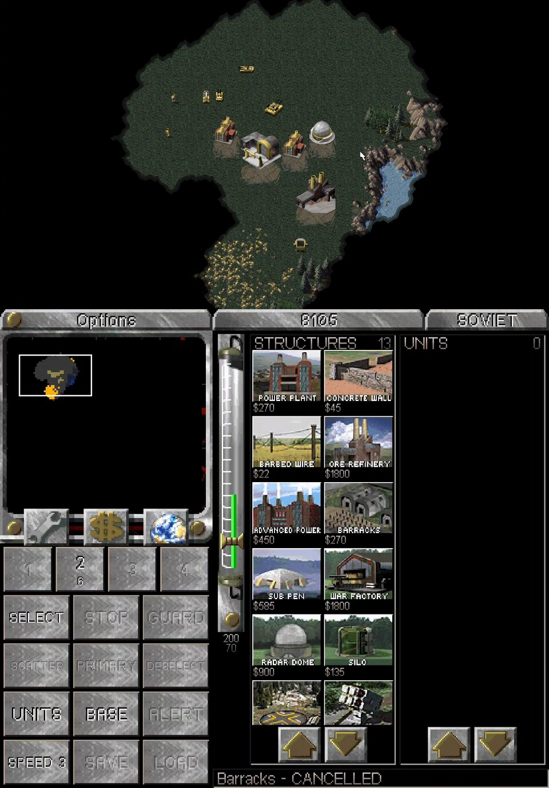

All Thor ports: [toravo.de/en/thor](https://toravo.de/en/thor/)

## Thor Conquer 0.5.0: the deck is the game's sidebar now, with a lot more on it

### New on the bottom screen
- **Game look:** the deck is drawn with the game's own interface art from your files: the tab bar, the radar housing of your side, REPAIR / SELL / MAP, the power bar with its drain marker, the strip arrows and the game's two sidebar fonts. Allies, Soviets, GDI and Nod each get their own. None of the art is in the app.
- **Control groups 1 to 4:** hold to store the selection, tap to pick it, tap again to look at it (the same groups as the D-pad's).
- **Order pad:** SELECT (tap = units in view, hold = the whole army), STOP, GUARD, SCATTER, PRIMARY for the selected factory, DESELECT.
- **Jumps:** UNITS, BASE (construction yard, then the factories), ALERT (last attack on your base).
- **Game speed:** one step faster per tap, six steps.
- **Quick save:** SAVE writes it, holding LOAD goes back to it (campaign missions).
- **Radar zoom:** MAP zooms the radar in around your view.
- **Build strips:** tap = build, tap again = hold, long-press now cancels in one go. Arrows scroll a strip.

### Tested on the Thor
Red Alert skirmish as the Soviets: build through the strips (hold, go on, cancel with one long press), place a refinery and a radar dome, radar with tap, drag and MAP zoom, units stored as groups 1 and 2 by holding and picked again, SELECT in view and whole army, STOP, GUARD, SCATTER, DESELECT, PRIMARY on the construction yard, UNITS and BASE jumps, REPAIR and SELL mode, game speed, strip arrows. Tiberian Dawn, GDI mission 1: the GDI look, groups, quick save and holding LOAD to go back, speed, the Options tab.

Not tested this time: the Allied and Nod art, the Tiberian Dawn radar and build strips with the new look, ALERT after a real attack, the controller (unchanged code), the German, Spanish and French labels, the compact layout.

### Updating
Install over 0.4.0, the game data stays.

### Known limitations
- No build queue: the classic engine builds one item per factory, as in the original games.
- Quick save and load work in campaign missions only; the engine does not save skirmish games.
- The deck's texts use the game's fonts, which have no accents: German, Spanish and French labels are shown without them.
- Before a mission starts the deck shows the standby screen: the game's art is only loaded once a mission runs.
- Covert Operations is not supported. The game itself is English only (see the README).

**You need your own game files** from the C&C Remastered Collection (Steam). No game data is included; the deck's art is read from your files while the game runs.

`ThorConquer-0.5.0.apk` · SHA-256 in `ThorConquer-0.5.0.apk.sha256` · signed with the same certificate as 0.3.x and 0.4.0.

Command & Conquer is a trademark of Electronic Arts. This fan project is not affiliated with EA.
